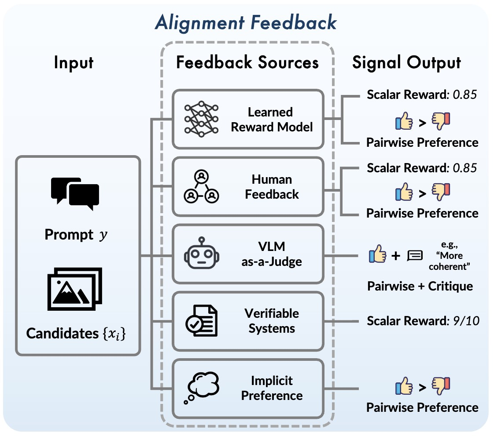
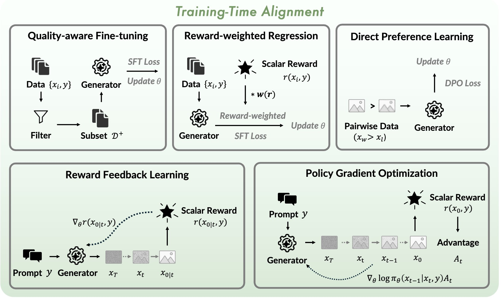

# Awesome-Alignment-of-Diffusion-Models

This repository is a curated collection of research papers, frameworks, and resources focusing on the **Alignment and Post-Training of Diffusion/Flow-matching Models**. 
As image and video generative models scale, aligning them with human preferences, physical constraints, and prompt adherence has become a critical paradigm.

This repository is updated continuously. We apologize for any omissions and welcome pull requests to merge them in.

---

## Table of Contents
- [1 Foundation Models](#1-foundation-models)
  - [1.1 Image Generation & Editing](#11-image-generation--editing)
  - [1.2 Video Generation](#12-video-generation)
- [2 Reward Model](#2-reward-model)
  - [2.1 CLIP-based](#21-clip-based)
  - [2.2 VLM-based](#22-vlm-based)
  - [2.3 Diffusion-based](#23-diffusion-based)
  - [2.4 Others](#24-others)
- [3 Training Alignment](#3-training-alignment)
  - [3.1 ReFL](#31-refl)
  - [3.2 DPO](#32-dpo)
  - [3.3 RWR](#33-rwr)
  - [3.4 RLHF](#34-rlhf)
  - [3.5 RLHF-GRPO](#35-rlhf-grpo)
- [4 Inference Alignment](#4-inference-alignment)
  - [4.1 Gradient Guidance](#41-gradient-guidance)
  - [4.2 Condition](#42-condition)
  - [4.3 Search](#43-search)
- [5 Download Tasks](#5-download-tasks)
  - [5.1 Human-centric AI & ID Preserving](#51-human-centric-ai--id-preserving)
  - [5.2 Control](#52-control)
  - [5.3 Long Video Generation](#53-long-video-generation)
  - [5.4 Distillation](#54-distillation)
  - [5.5 3D](#55-3d)
- [Contact & Contributions](#7-contact--contributions)

---

# 1 Foundation Models

## 1.1 Image Generation & Editing

- ![DPO] Scaling Rectified Flow Transformers for High-Resolution Image Synthesis. [](https://arxiv.org/abs/2403.03206) (StableDiffusion 3 from Stability AI).

- ![SFT] SANA 1.5: Efficient Scaling of Training-Time and Inference-Time Compute in Linear Diffusion Transformer [](https://arxiv.org/abs/2501.18427) (from NVIDIA)

- ![SFT] ![ReFL] Seedream 2.0: A Native Chinese-English Bilingual Image Generation Foundation Model [](https://arxiv.org/abs/2503.07703) (from  ByteDance Seed Team)

- ![SFT] ![ReFL] Seedream 3.0 Technical Report [](https://arxiv.org/abs/2504.11346) (from ByteDance Seed Team)

- ![SFT] HiDream-I1: A High-Efficient Image Generative Foundation
Model with Sparse Diffusion Transformer. [](https://arxiv.org/abs/2505.22705) (from HiDream Team)

- ![SFT] ![DPO] ![GRPO] Qwen-Image Technical Report [](https://arxiv.org/abs/2508.02324) (from Qwen Team)

- ![SFT] ![ReFL] ![GRPO] Seedream 4.0: Toward Next-generation Multimodal Image Generation [](https://arxiv.org/abs/2509.20427) (from ByteDance Seed Team)

- ![SFT] ![DPO] ![GRPO] Z-Image: An Efficient Image Generation Foundation Model with Single-Stream Diffusion Transformer [](https://arxiv.org/abs/2511.22699) (from Alibaba Z-Image Team)

- ![SFT] ![DPO] ![GRPO] Ovis-Image Technical Report. [](https://arxiv.org/abs/2511.22982) (from Alibaba Ovis Team)

- ![SFT] ![DPO] ![GRPO] LongCat-Image Technical Report [](https://arxiv.org/abs/2512.07584) (from Meituan LongCat Team)

## 1.2 Video Generation

- ![ReFL] T2v-turbo: Breaking the quality bottleneck of video consistency model with mixed reward feedback. [](https://arxiv.org/abs/2405.18750)

- ![SFT] Movie Gen: A Cast of Media Foundation Models. [](https://arxiv.org/abs/2410.13720) (from Meta)

- ![SFT] Cosmos World Foundation Model Platform for Physical AI.  [](https://arxiv.org/abs/2501.03575) (from NVIDIA)

- ![SFT] ![DPO] Step-Video-T2V Technical Report: The Practice, Challenges, and Future of Video Foundation Model. [](https://arxiv.org/abs/2502.10248) (from Step-Video Team)

- ![SFT] Wan: Open and Advanced Large-Scale Video Generative Models. [](https://arxiv.org/abs/2503.20314) (from Alibaba Wan Team)

- ![SFT] ![DPO] Skyreels-v2: Infinite-length film generative model. [](https://arxiv.org/abs/2504.13074) (from SkyRells Team)

- ![SFT] ![ReFL] Seedance 1.0: Exploring the Boundaries of Video Generation Models. [](https://arxiv.org/abs/2506.09113) (from ByteDance Seed Team)

- ![SFT] ![GRPO] LongCat-Video Technical Report. [](https://arxiv.org/abs/2510.22200) (from Meituan LongCat Team)

- ![SFT] ![GRPO] World Simulation with Video Foundation Models for Physical AI. [](https://arxiv.org/abs/2511.00062) (from Nvidia Cosmos Team)

- ![SFT] ![DPO] ![GRPO] HunyuanVideo 1.5 Technical Report. [](https://arxiv.org/abs/2511.18870) (from Tencent Hunyuan Team)

- ![SFT] ![ReFL] ![GRPO] Seedance 1.5 pro: A Native Audio-Visual Joint Generation Foundation Model. [](https://arxiv.org/abs/2512.13507) (from ByteDance Seed Team)

# 2 Reward Model

<div align=center>

</div>

## 2.1 CLIP-based

- ![image] Laion-5b: An open large-scale dataset for training next generation image-text models. [](https://arxiv.org/abs/2210.08402)

- ![image] Human Preference Score: Better Aligning Text-to-Image Models with Human Preference. [](https://arxiv.org/abs/2303.14420)

- ![image] Imagereward: Learning and evaluating human preferences for text-to-image generation. [](https://arxiv.org/abs/2304.05977)

- ![image] Pick-a-Pic: An Open Dataset of User Preferences for Text-to-Image Generation. [](https://arxiv.org/abs/2305.01569)

- ![image] Human Preference Score v2: A Solid Benchmark for Evaluating Human Preferences of Text-to-Image Synthesis. [](https://arxiv.org/abs/2306.09341)

- ![image] Rich Human Feedback for Text-to-Image Generation. [](https://arxiv.org/abs/2312.10240)

- ![image] Learning Multi-dimensional Human Preference for Text-to-Image Generation. [](https://arxiv.org/abs/2405.14705)

## 2.2 VLM-based

- ![image] Multimodal Large Language Models Make Text-to-Image Generative Models Align Better. [](https://arxiv.org/abs/2404.15100)

- ![video] VideoScore: Building Automatic Metrics to Simulate Fine-grained Human Feedback for Video Generation. [](https://arxiv.org/abs/2406.15252)

- ![video] LiFT: Leveraging Human Feedback for Text-to-Video Model Alignment. [](https://arxiv.org/abs/2412.04814)

- ![video] Improving Video Generation with Human Feedback [](https://arxiv.org/abs/2501.13918)

- ![image] Teaching Large Language Models to Regress Accurate Image Quality Scores using Score Distribution. [](https://arxiv.org/abs/2501.11561)

- ![image] Multimodal LLMs as Customized Reward Models for Text-to-Image Generation. [](https://arxiv.org/abs/2507.21391)

- ![image] HPSv3: Towards Wide-Spectrum Human Preference Score. [](https://arxiv.org/abs/2508.03789)

- ![edit] Onereward: Unified mask-guided image generation via multi-task human preference learning. [](https://arxiv.org/abs/2508.21066)

- ![image] ![video] RewardDance: Reward Scaling in Visual Generation. [](https://arxiv.org/abs/2509.08826)

- ![edit] Skywork unipic 2.0: Building kontext model with online rl for unified multimodal model. [](https://arxiv.org/abs/2509.04548)

- ![edit] Uniworld-V2: Reinforce Image Editing with Diffusion Negative-aware Finetuning and MLLM Implicit Feedback. [](https://arxiv.org/abs/2510.16888)

- ![image] ![video] Unified Reward Model for Multimodal Understanding and Generation. [](https://arxiv.org/abs/2503.05236)

- ![image] ![video] Unified Multimodal Chain-of-Thought Reward Model through Reinforcement Fine-Tuning. [](https://arxiv.org/abs/2505.03318)

- ![image] VisualQuality-R1: Reasoning-Induced Image Quality Assessment via Reinforcement Learning to Rank. [](https://arxiv.org/abs/2505.14460)

- ![video] VideoScore2: Think before You Score in Generative Video Evaluation. [](https://arxiv.org/abs/2509.22799)

- ![edit] Edit-R1: Unleashing Reasoning-Based Reinforcement Learning for Image Editing. [](https://openreview.net/pdf?id=hKWCGxuD5v)

- ![video] Vr-thinker: Boosting video reward models through thinking-with-image reasoning. [](https://arxiv.org/abs/2510.10518).

- ![image] ![video] Unified Personalized Reward Model for Vision Generation. [](https://arxiv.org/abs/2602.02380)

- ![video] Thinking with Frames: Generative Video Distortion Evaluation via Frame Reward Model. [](https://arxiv.org/abs/2601.04033)

- ![image] ![video] Visionreward: Fine-grained multi-dimensional human preference learning for image and video generation. [](https://arxiv.org/abs/2412.21059)

- ![image] Generative Universal Verifier as Multimodal Meta-Reasoner. [](https://arxiv.org/abs/2510.13804)

- ![image] RubricRL: Simple Generalizable Rewards for Text-to-Image Generation. [](https://arxiv.org/abs/2511.20651)

## 2.3 Diffusion-based

- ![image] Diffusion Model as a Noise-Aware Latent Reward Model for Step-Level Preference Optimization. [](https://arxiv.org/abs/2502.01051)

- ![video] Video Generation Models Are Good Latent Reward Models. [](https://arxiv.org/abs/2511.21541)

- ![image] Beyond VLM-Based Rewards: Diffusion-Native Latent Reward Modeling. [](https://arxiv.org/abs/2602.11146)

## 2.4 Others

- ![video] MIND-V: Hierarchical Video Generation for Long-Horizon Robotic Manipulation with RL-based Physical Alignment. [](https://arxiv.org/abs/2512.06628) (V-JEPA based)

# 3 Training Alignment

<div align=center>

</div>

## 3.1 ReFL

- Imagereward: Learning and evaluating human preferences for text-to-image generation. [](https://arxiv.org/abs/2304.05977)

- (DRAFT) Directly Fine-Tuning Diffusion Models on Differentiable Rewards. [](https://arxiv.org/abs/2309.17400)

- (AlignProp) Aligning Text-to-Image Diffusion Models with Reward Backpropagation. [](https://arxiv.org/abs/2310.03739v2)

- InstructVideo: Instructing Video Diffusion Models with Human Feedback. [](https://arxiv.org/abs/2312.12490)

- UniFL: Improve Latent Diffusion Model via Unified Feedback Learning. [](https://arxiv.org/abs/2404.05595)

- Video diffusion alignment via reward gradients. [](https://arxiv.org/abs/2407.08737)

- RLGF: Reinforcement Learning with Geometric Feedback for Autonomous Driving Video Generation. [](https://arxiv.org/abs/2509.16500)

## 3.2 DPO

``` markdown
Trends:
1. Global preference --> step-aware preference;
2. Denser preference signals (patch-level, frame-level);
3. Offline DPO --> Online DPO;
4. Emphasizes learning more from positive/negative samples;
5. Constructing implicit preference pairs (real vs. gen, curr vs. ema, self-play);
```

- Diffusion Model Alignment Using Direct Preference Optimization. [](https://arxiv.org/abs/2311.12908)

- Using human feedback to fine-tune diffusion models without any reward model. [](https://arxiv.org/abs/2311.13231)

- Self-play fine-tuning of diffusion models for text-to-image generation. [](https://arxiv.org/abs/2402.10210)

- A Dense Reward View on Aligning Text-to-Image Diffusion with Preference. [](https://arxiv.org/abs/2402.08265)

- Boost Your Human Image Generation Model via Direct Preference Optimization. [](https://arxiv.org/abs/2405.20216) (real image as the gt);

- Aesthetic Post-Training Diffusion Models from Generic Preferences with Step-by-step Preference Optimization. [](https://arxiv.org/abs/2406.04314)

- Diffusion-rpo: Aligning diffusion models through relative preference optimization. [](https://arxiv.org/abs/2406.06382)

- Scalable Ranked Preference Optimization for Text-to-Image Generation. [](https://arxiv.org/abs/2410.18013)
rankdpo

- PatchDPO: Patch-level DPO for Finetuning-free Personalized Image Generation. [](https://arxiv.org/abs/2412.03177)

- Align Video Diffusion Model with Online Video-Centric Preference Optimization. [](https://arxiv.org/abs/2412.15159)

- Videodpo: Omni-preference alignment for video diffusion generation. [](https://arxiv.org/abs/2412.14167)

- Improving Video Generation with Human Feedback [](https://arxiv.org/abs/2501.13918)

- Calibrated Multi-Preference Optimization for Aligning Diffusion Models. [](https://arxiv.org/abs/2502.02588)

- InPO: Inversion Preference Optimization with Reparametrized DDIM for Efficient Diffusion Model Alignment. [](https://arxiv.org/abs/2503.18454)

- Fine-Tuning Diffusion Generative Models via Rich Preference Optimization. [](https://arxiv.org/abs/2503.11720)

- Rethinking DPO-style Diffusion Aligning Frameworks. [](https://openaccess.thecvf.com/content/ICCV2025/papers/Wu_Rethinking_DPO-style_Diffusion_Aligning_Frameworks_ICCV_2025_paper.pdf)

- Positive Enhanced Preference Alignment for Text-to-Image Models. [](https://ieeexplore.ieee.org/stamp/stamp.jsp?arnumber=10890823&casa_token=6w7bBUPdGDMAAAAA:gWxaIXtzwGOAUWl4wEHVpBCNsxRHZqWIepc2imE1D8mqWrm9n8eA9f9oD0bo2JcboFnmRh1UDYs&tag=1)
optimize positive

- Diffusion-npo: Negative preference optimization for better preference aligned generation of diffusion models. [](https://arxiv.org/abs/2505.11245)

- DenseDPO: Fine-Grained Temporal Preference Optimization for Video Diffusion Models. [](https://arxiv.org/abs/2506.03517)

- Hierarchical Fine-grained Preference Optimization for Physically Plausible Video Generation. [](https://arxiv.org/abs/2508.10858)

- Follow-Your-Preference: Towards Preference-Aligned Image Inpainting. [](https://arxiv.org/abs/2509.23082)

- Direct Discriminative Optimization: Your Likelihood-Based Visual Generative Model is Secretly a GAN Discriminator. [](https://arxiv.org/abs/2503.01103)

- Diffusionnft: Online diffusion reinforcement with forward process. [](https://arxiv.org/abs/2509.16117)

- RealDPO: Real or Not Real, that is the Preference. [](https://arxiv.org/abs/2510.14955)

- Towards Better Optimization For Listwise Preference in Diffusion Models. [](https://arxiv.org/abs/2510.01540)

- Direct Diffusion Score Preference Optimization via Stepwise Contrastive Policy-Pair Supervision. [](https://arxiv.org/abs/2512.23426)

- PhyGDPO: Physics-Aware Groupwise Direct Preference Optimization for Physically Consistent Text-to-Video Generation. [](https://arxiv.org/abs/2512.24551)

- Mind the Generative Details: Direct Localized Detail Preference Optimization for Video Diffusion Models. [](https://arxiv.org/abs/2601.04068)

## 3.3 RWR

- Advantage-weighted regression: Simple and scalable off-policy reinforcement learning. [](https://arxiv.org/abs/1910.00177)

- Aligning text-to-image models using human feedback. [](https://arxiv.org/abs/2302.12192)

- Raft: Reward ranked finetuning for generative foundation model alignment. [](https://arxiv.org/abs/2304.06767)

- Online Reward-Weighted Fine-Tuning of Flow Matching with Wasserstein Regularization. [](https://arxiv.org/abs/2502.06061)

- GigaVideo-1: Advancing Video Generation via Automatic Feedback with 4 GPU-Hours Fine-Tuning. [](https://arxiv.org/abs/2506.10639)

## 3.4 RLHF

- Optimizing ddpm sampling with shortcut fine-tuning。 [](https://arxiv.org/abs/2301.13362)

- Training Diffusion Models with Reinforcement Learning. [](https://arxiv.org/abs/2305.13301)

- DPOK: Reinforcement Learning for Fine-tuning Text-to-Image Diffusion Models. [](https://arxiv.org/abs/2305.16381)

- Training Diffusion Models Towards Diverse Image Generation with Reinforcement Learning. [](https://arxiv.org/abs/2305.13301v4)

- A Simple and Effective Reinforcement Learning Method for Text-to-Image Diffusion Fine-tuning. [](https://arxiv.org/abs/2503.00897)

## 3.5 RLHF-GRPO

``` markdown
Trends:
1. Efficiency: sample efficiency, optimization efficiency (like sparse-step updates), faster reward acquisition；
2. Avid reward hacking, like stronger trust-region control and improved sampling diversity;
3. Dense reward signals, precise credit assign;
4. Support for diverse reward functions, including verifiers and pairwise comparisons;
```

- Flow-GRPO: Training Flow Matching Models via Online RL. [](https://arxiv.org/abs/2505.05470)

- DanceGRPO: Unleashing GRPO on Visual Generation. [](https://arxiv.org/abs/2505.07818)

- Tempflow-grpo: When timing matters for grpo in flow models. [](https://arxiv.org/abs/2508.04324)

- Pref-grpo: Pairwise preference reward-based grpo for stable text-to-image reinforcement learning. [](https://arxiv.org/abs/2508.20751)

- Coefficients-Preserving Sampling for Reinforcement Learning with Flow Matching. [](https://arxiv.org/abs/2508.20751)

- Branchgrpo: Stable and efficient grpo with structured branching in diffusion models. [](https://arxiv.org/abs/2509.06040)

- Reinforcement Learning with Inverse Rewards for World Model Post-training. [](https://arxiv.org/abs/2509.23958)

- Advantage weighted matching: Aligning rl with pretraining in diffusion models. [](https://arxiv.org/abs/2509.25050)

- Smart-GRPO: Smartly Sampling Noise for Efficient RL of Flow-Matching Models. [](https://arxiv.org/abs/2510.02654)

- Understanding Sampler Stochasticity in Training Diffusion Models for RLHF. [](https://arxiv.org/abs/2510.10767)

- G2RPO: Granular GRPO for Precise Reward in Flow Models. [](https://arxiv.org/abs/2510.01982)

- Sample By Step, Optimize By Chunk: Chunk-Level GRPO For Text-to-Image Generation. [](https://arxiv.org/abs/2510.21583)

- GRPO-Guard: Mitigating Implicit Over-Optimization in Flow Matching via Regulated Clipping. [](https://arxiv.org/abs/2510.22319)

- Reinforcing Diffusion Models by Direct Group Preference Optimization. [](https://arxiv.org/abs/2510.08425)

- Seeing What Matters: Visual Preference Policy Optimization for Visual Generation. [](https://arxiv.org/abs/2511.18719)

- Neighbor GRPO: Contrastive ODE Policy Optimization Aligns Flow Models. [](https://arxiv.org/abs/2511.16955)

- The Image as Its Own Reward: Reinforcement Learning with Adversarial Reward for Image Generation. [](https://arxiv.org/abs/2511.20256)

- ProxT2I: Efficient Reward-Guided Text-to-Image Generation via Proximal Diffusion. [](https://arxiv.org/abs/2511.18742)

- Multi-GRPO: Multi-Group Advantage Estimation for Text-to-Image Generation with Tree-Based Trajectories and Multiple Rewards. [](https://arxiv.org/abs/2512.00743)

- Data-regularized Reinforcement Learning for Diffusion Models at Scale. [](https://arxiv.org/abs/2512.04332)

- RealGen: Photorealistic Text-to-Image Generation via Detector-Guided Rewards. [](https://arxiv.org/abs/2512.00473)

- GARDO: Reinforcing Diffusion Models without Reward Hacking. [](https://arxiv.org/abs/2512.24138)

- Beyond the Dirac Delta: Mitigating Diversity Collapse in Reinforcement Fine-Tuning for Versatile Image Generation. [](https://arxiv.org/abs/2601.12401)

- Diffusion Alignment Beyond KL: Variance Minimisation as Effective Policy Optimiser. [](https://arxiv.org/abs/2602.12229)

- UniRef-Image-Edit: Towards Scalable and Consistent Multi-Reference Image Editing. [](https://arxiv.org/abs/2602.14186)

# 4 Inference Alignment

## 4.1 Gradient Guidance

- Universal guidance for diffusion models. [](https://arxiv.org/abs/2302.07121)

- End-to-end diffusion latent optimization improves classifier guidance. [](https://arxiv.org/abs/2303.13703)

- Gradient Guidance for Diffusion Models: An Optimization Perspective. [](https://arxiv.org/abs/2404.14743)

- Reno: Enhancing one-step text-to-image models through reward-based noise optimization. [](https://arxiv.org/abs/2406.04312)

- Not all noises are created equally: Diffusion noise selection and optimization. [](https://arxiv.org/abs/2407.14041)

- Golden noise for diffusion models: A learning framework. [](https://arxiv.org/abs/2411.09502)

- A noise is worth diffusion guidance. [](https://arxiv.org/abs/2412.03895)

## 4.2 Condition

- ReNeg: Learning Negative Embedding with Reward Guidance. [](https://arxiv.org/abs/2412.19637)

- Prompt-a-video: Prompt your video diffusion model via preference-aligned llm. [](https://arxiv.org/abs/2412.15156)

- IMG: Calibrating Diffusion Models via Implicit Multimodal Guidance. [](https://arxiv.org/abs/2509.26231)

- Plug-and-Play Prompt Refinement via Latent Feedback for Diffusion Model Alignment. [](https://arxiv.org/abs/2510.00430)

## 4.3 Search

- Test-time Alignment of Diffusion Models without Reward Over-optimization. [](https://arxiv.org/abs/2501.05803)

- Inference-time scaling for diffusion models beyond scaling denoising steps. [](https://arxiv.org/abs/2501.09732)

- A general framework for inference-time scaling and steering of diffusion models. [](https://arxiv.org/abs/2501.06848)

- Inference-time text-to-video alignment with diffusion latent beam search. [](https://arxiv.org/abs/2501.19252)

- Training-free guidance beyond differentiability: Scalable path steering with tree search in diffusion and flow models. [](https://arxiv.org/abs/2502.11420)

- Dynamic Search for Inference-Time Alignment in Diffusion Models. [](https://arxiv.org/abs/2503.02039)

- Inference-time scaling for flow models via stochastic generation and rollover budget forcing. [](https://arxiv.org/abs/2503.19385)

- Scaling image and video generation via test-time evolutionary search. [](https://arxiv.org/abs/2505.17618)

# 5 Download Tasks

## 5.1 Human-centric AI & ID Preserving

- Identity-preserving image-to-video generation via reward-guided optimization. [](https://arxiv.org/abs/2510.14255)

- Disco: Reinforcement with diversity constraints for multi-human generation. [](https://arxiv.org/abs/2510.01399)

- PSR: Scaling Multi-Subject Personalized Image Generation with Pairwise Subject-Consistency Rewards. [](https://arxiv.org/abs/2512.01236)

## 5.2 Control

- Itercomp: Iterative composition-aware feedback learning from model gallery for text-to-image generation. [](https://arxiv.org/abs/2410.07171)

- Taming Camera-Controlled Video Generation with Verifiable Geometry Reward. [](https://arxiv.org/abs/2512.02870)

## 5.3 Long Video Generation

- Self-Forcing++: Towards Minute-Scale High-Quality
Video Generation. [](https://arxiv.org/abs/2510.02283)

- Reward Forcing: Efficient Streaming Video Generation with Rewarded Distribution Matching Distillation. [](https://arxiv.org/abs/2512.04678)

## 5.4 Distillation

- Distribution Matching Distillation Meets Reinforcement Learning. [](https://arxiv.org/abs/2511.13649)

- Flash-DMD: Towards High-Fidelity Few-Step Image Generation with Efficient Distillation and Joint Reinforcement Learning. [](https://arxiv.org/abs/2511.20549)

## 5.5 3D

- Dreamreward: Text-to-3d generation with human preference. [](https://arxiv.org/abs/2403.14613)

- DreamDPO: Aligning Text-to-3D Generation with Human Preferences via Direct Preference Optimization. [](https://arxiv.org/abs/2502.04370)

- Are We Ready for RL in Text-to-3D Generation? A Progressive Investigation. [](https://arxiv.org/abs/2512.10949)

# 7 Contact & Contributions

For any questions, suggestions or discussions, please feel free ti reach out to [me](https://gongyeliu.github.io/) at `gongyeliuu@gmail.com`.


[DPO]: https://img.shields.io/badge/-DPO-blue
[GRPO]: https://img.shields.io/badge/-GRPO-success
[ReFL]: https://img.shields.io/badge/-ReFL-orange
[SFT]: https://img.shields.io/badge/-SFT-green

[image]: https://img.shields.io/badge/-Image-blue
[video]: https://img.shields.io/badge/-Video-success
[edit]: https://img.shields.io/badge/-Edit-orange
